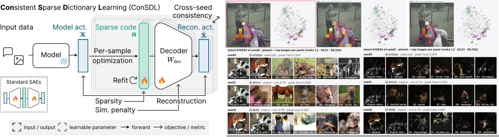

# ConSDL: Consistent Sparse Dictionary Learning

Project page: [`docs/`](docs/).



Code for the paper's experiments: the ConSDL training objective, the six
SAE baselines it is compared against, the cross-seed consistency and
reconstruction metrics, and the synthetic benchmark with a known
ground-truth dictionary.

## Install

```bash
conda create -n consdl python=3.12 -y && conda activate consdl
pip install torch            # pick the build for your CUDA version
pip install third_party/fastsae/third_party/config_dataclass-0.3.0-py3-none-any.whl
pip install -e third_party/fastsae
pip install -e .
```

## Training and evaluation

Every entry point is a module under `consdl.cli` and documents its flags
with `--help`. A *cell* is one (architecture, dictionary size, sparsity)
setting trained for several seeds (`seed0/`, `seed1/`, ...); the
consistency metrics compare the seeds. Checkpoints go to
`var/checkpoints/`, metrics to the mirrored path under `var/results/`.

**Vision** (CLIP / DINOv2 patch tokens) and **language models** (residual
stream of one layer): a sweep trains every cell × seed, then writes the
dictionary metrics (DCS, #dead, #dup) and code metrics (MCC, input R²).
```bash
# CLIP ViT-B/16, 16x, L0 ≈ 64 (values from the paper's hyper-parameter table)
python -m consdl.cli.sweep vision --backbone clip-vit-b-16 --layer 10 \
    --archs consdl relu topk --levels l0_64 --values consdl=1.25 relu=1.3e-4 topk=64 \
    --refit-iters 10 --co-active-sim-coefficient 5e-3 \
    --expansions 16 --seeds 0 1 2 --gpus 0 1 -- --fista-iters 30

# Pythia-160M, 16x, L0 ≈ 64
python -m consdl.cli.sweep lm --backbone pythia-160m --hook-layer 8 \
    --archs consdl relu topk --levels l0_64 --values consdl=1.5 relu=8.0e-5 topk=64 \
    --refit-iters 26 --co-active-sim-coefficient 5e-3 \
    --expansions 16 --seeds 0 1 2 --gpus 0 1 -- --fista-iters 50
```
`--levels` names the sparsity levels (the cell directories) and
`--values` gives each architecture's sparsity knob per level, comma
separated in `--levels` order: the L1 coefficient (`relu`), k (`topk`,
`batchtopk`, `matryoshka`, `mp`, `isae`) or λ (`sc`, `refit`, `consdl`).
Arguments after `--` go to every training run. The per-cell λ,
T<sub>FISTA</sub>, T<sub>refit</sub> and γ are in the paper's appendix
hyper-parameter table. The steps can also be run one by one:
```bash
python -m consdl.cli.train_vision ...     # or train_lm; also writes the firing stats
python -m consdl.cli.dict_metrics --tree var/checkpoints/vision
python -m consdl.cli.code_metrics --tree var/checkpoints/vision --modality vision --full-pool
python -m consdl.cli.code_metrics --tree var/checkpoints/vision --modality vision --full-pool --mp-k 32 64 128
```
`--full-pool` measures MCC and input R² on the paper's pools:

* **vision**: 3 images of every ImageNet validation class (3,000 images,
  591k CLIP / 771k DINOv2 patch tokens), drawn with a fixed seed — class
  coverage changes MCC more than pool size does;
* **language**: the first 600k tokens of the FineWeb activations that the
  post-training stats pass (`consdl.cli.stats_lm`) caches.

MP-SAE's sparsity is its inference round count rather than its weights,
so `--mp-k` evaluates MP cells once per target L0 (one json per k).

**Synthetic benchmark** (known ground-truth dictionary): build the
dictionary, train each seed, then compute ground-truth recovery and
cross-seed metrics.
```bash
python -m consdl.cli.build_dictionary --geometry gaussian --d 768 --d-sae 6144 --out D_gt.pt
python -m consdl.cli.train_synthetic --gpu 0 --seed 0 --gt-dict D_gt.pt \
    --distribution uniform --k-active 60 --architecture fista ... \
    --experiment-dir var/checkpoints/synthetic/<cell>/seed0
python -m consdl.cli.dict_metrics_synthetic --tree var/checkpoints/synthetic
python -m consdl.cli.code_metrics_synthetic --tree var/checkpoints/synthetic --gpu 0
```

## Pretrained checkpoints

Every vision and language SAE in the paper's tables (4 backbones × 3
dictionary sizes × 3 sparsity levels × 7 methods × 3 seeds) is on the
Hugging Face Hub, in the same layout the sweeps write:
`<modality>/<backbone>_layer<L>/<arch>/x<E>/<level>/seed<S>`, where
`<level>` is the target L0 (`l0_32`, `l0_64`, `l0_128`).
```python
from consdl.io.hub import load_pretrained
sae = load_pretrained("vision/clip-vit-b-16_layer10/consdl/x16/l0_64/seed0")
```

## Viewers

Two interactive pages, served per backbone behind one hub:

* **Latent explorer** (`/explore`): pick an input (an ImageNet val image, an
  upload, typed text or a FineWeb window) and see how each SAE of a view
  decomposes it. Each card shows the input coloured by its latents (by
  dictionary cluster, by a region carve at k, or as one latent's heatmap) next
  to that SAE's decoder UMAP. Hovering a patch or token rings its active
  latents. Hovering a latent shows its heatmap, its matched latent in the other
  panels and its top inputs.
* **Cluster consistency** (`/view`): the decoder atoms of several dictionaries
  (the seeds of one cell, seed 0 of every cell of one arch, or seed 0 of every
  arch for one cell) on one joint UMAP. Colours are seed 0's spherical k-means
  clusters (48 atoms per cluster). Hovering an atom shows its Hungarian or
  nearest-neighbour match in every other dictionary, the atoms within a cosine
  threshold of it, and each match's top inputs. A chart counts every
  dictionary's atoms per anchor cluster.

Build the data from any checkpoint tree in the release layout (the Hub
download or `var/checkpoints/<modality>`) into `var/results/viewers/`, then
launch:
```bash
python -m consdl.cli.viewer_precompute --root var/release \
    --backbones clip-vit-b-16_layer10 pythia-160m_layer8 --expansions 16 --seeds 3 \
    --images-per-class 10 --lm-seqs 2048
python -m consdl.cli.viewer --backbones clip-vit-b-16_layer10 pythia-160m_layer8 --port 8760
# -> http://<host>:8760/ (one server per backbone on 8761, 8762, ...)
```
`viewer_precompute` takes `--root` (a release root, a modality dir or one
`<backbone>_layer<L>` dir), `--backbones`, `--archs`, `--expansions`,
`--levels`, `--seeds N` (first N seeds per cell), `--stages`,
`--images-per-class` (vision pool, default all 50), `--lm-seqs` (LM pool of
1024-token FineWeb sequences, default 2048), `--out-root` and `--force`.
`viewer` takes `--backbones`, `--views-root`, `--port` (the hub) and
`--backend-ports` (default `--port`+1, +2, ...). Open the hub URL it prints.
The top bar has a backbone selector, grouped by modality, and tabs for the
two pages. The choice is kept in a cookie, and `?bb=<backbone>` selects one
in a link. From a laptop, tunnel the hub port first:
`ssh -N -L 8760:<node>:8760 <login-host>`, then open `http://localhost:8760/`.

The precompute stages are `kmeans`, `figures` (cluster-size curves),
`views`, `archviews` and `tops`; `--stages` and `--archs` split them across
jobs. Only `tops` needs a GPU. It encodes an input pool and keeps each
latent's top 100 inputs, because the released stats hold per-latent scalars
only. Vision images are ranked by their peak |a| over patches, and the pass
also stores per-image footprints for the footprint-cosine readout. LM tokens
are ranked by |a|. The servers need a GPU to encode inputs live. Panels with
no top inputs say so.

## Architectures

| `--archs` (sweeps) | `--architecture` (training) | |
|---|---|---|
| `relu` | `relu` | L1-penalised ReLU SAE (LM runs add neuron resampling: `--use-resampling`) |
| `topk` | `topk` | TopK, AuxK revival from step 0 |
| `batchtopk` | `batchtopk` | BatchTopK |
| `matryoshka` | `matryoshka` | Matryoshka BatchTopK |
| `mp` | `mp` | MP-SAE (matching-pursuit encoder) |
| `isae` | `isae` | iSAE: AbsTopK + aRIP (`isae_me` = iterative encoder) |
| `sc` / `refit` / `consdl` | `fista` + options below | **ConSDL** and its ablations |

ConSDL and its ablation rows are all the FISTA sparse-coding model with
options switched on:

| Ablation row | flags on top of `--architecture fista --l1-coeff λ` |
|---|---|
| Sparse coding (`sc`) | — |
| + Refitting (`refit`) | `--refit --refit-iters T` |
| + Co-active similarity regularization (`consdl`) | the above plus `--co-active-sim-coefficient γ --co-active-sim-refresh-steps 1 --co-active-sim-barrier-margin 0.5` |

The per-cell values of λ, T and γ are listed in the paper's appendix
hyper-parameter table.

## Layout

```
src/consdl/
  models/     SAE architectures (fista = ConSDL and its ablations; topk, batchtopk,
              matryoshka, mp, isae; ReLU is fastsae's VanillaSAE)
  training/   trainer (with the co-active similarity term), resume
  data/       vision and LM backbones and data; synthetic/ = ground-truth
              dictionaries and sparse-code data
  stats/      per-latent firing statistics (alive mask, dead counts, L0)
  metrics/    dictionary (DCS, #dead, #dup) and code (MCC, input R²) metrics
  io/         checkpoints, paths, Hugging Face Hub download
  viewers/    latent explorer and cluster-consistency view (servers, hub, precompute)
  cli/        every entry point: train_*, sweep, stats_*, dict_metrics*,
              code_metrics*, build_dictionary, viewer, viewer_precompute
third_party/fastsae/  the SAE training library everything builds on (vendored)
var/          (created at run time) checkpoints/, results/, cache/, logs/
```

## License

Released under the MIT License (see `LICENSE`). `third_party/fastsae`
keeps the notice in its own `NOTICE.md`.
